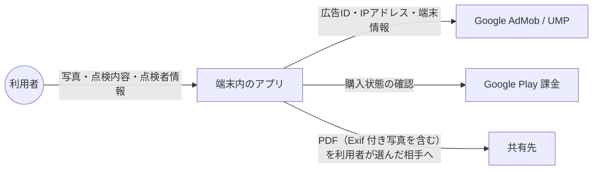
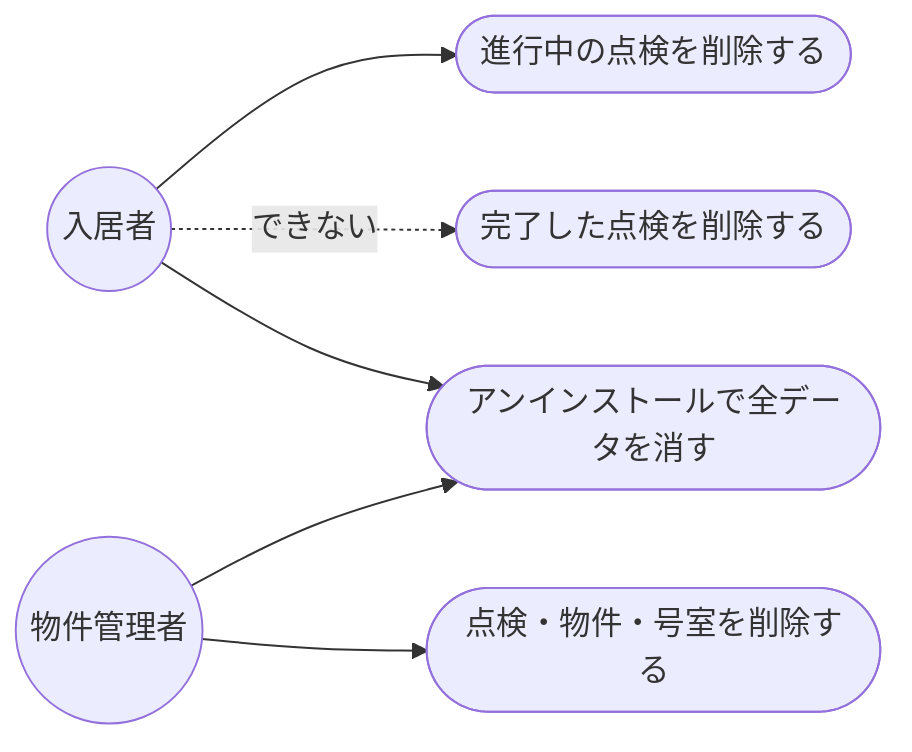
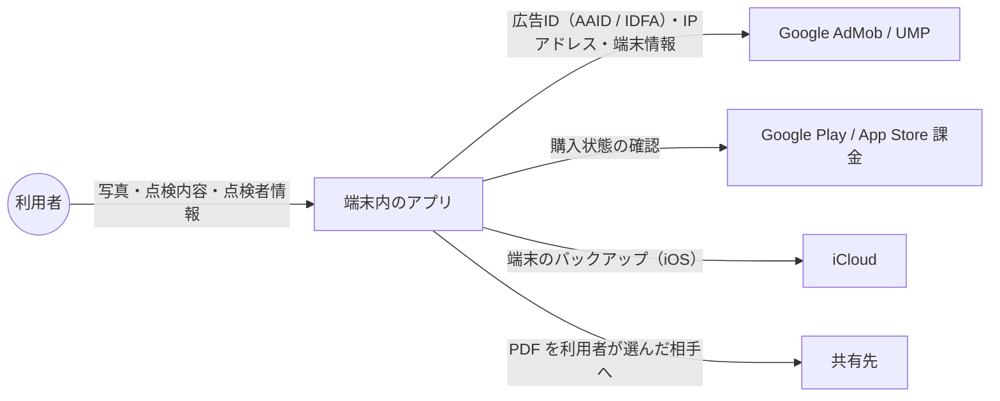

<!-- draft:common:start -->
## 背景

ポリシー類（プライバシーポリシー・利用規約・特定商取引法に基づく表記）が、アプリ「入居前チェック / Room Check PDF」の実際の動きと合っているかを確かめたい、という依頼です。アプリのソース（`arrow-code-lab/room-check-pdf` の origin/main 1b64f41、2026-11-01 時点）を読み、3 文書と 1 項目ずつ突き合わせました。

## 照合の結果

**実態と合っていた点:** 点検データは端末内だけに保存されること、外部へ送るのは AdMob（広告）・UMP（同意）・Google Play 課金だけであること、分析やクラッシュレポートの SDK が無いこと、位置情報の取り方（カメラ画面を開いている間だけ・既定はオフ・事前に説明）、PDF に Exif（撮影日時・位置・機種）が残ること、Android のバックアップ除外、PDF 一時ファイルの起動時削除、月額プランの自動更新と解約の説明。

**食い違い（このリポジトリで直すもの）:**

1. **パッケージ名が違う。** ポリシーは「room_check_pdf」と書いているが、ストアで使う ID は `room.check.pdf`（`room_check_pdf` はソース内部の名前）
2. **「アプリ内の削除操作で消せる」が、入居者モードでは成り立たない。** 入居者モードで完了した点検は、仕様上アプリ内で削除できず永久に保持される（月 1 回の作成制限の抜け道を防ぐため）。いまのポリシー 5 章・7 章は「削除操作かアンインストールまで保持」「削除機能で削除できる」としか書いていない
3. **全データを一度に消す機能が無い。** 全部を消す手段はアンインストールだけ（または Android の「ストレージを消去」）。7 章にこの手段が書かれていない
4. **物件情報に住所・郵便番号が含まれる。** 2 章は「物件名・部屋番号等」としか書いていない
5. **水準器（傾き表示）のためのセンサーを使っている。** 加速度センサーを撮影画面で使うが、権限が要らないため 3 章に記載が無い（端末外へは出ない）
6. 日本語版の公開 URL の末尾に `/` が無い（英語版にはある）

**このリポジトリの外にある問題（参考。今回は直さない）:**

- ストア掲載文・README の「インターネット接続不要」「外部送信なし」は、広告（AdMob）がある以上ポリシーと矛盾する
- iOS 版はポリシー（Android 前提）に対応していない（IDFA・ATT・App Store 課金・iCloud バックアップが除外されていない等）。iOS で出すならポリシー側にも追記が要る

## ゴール

ポリシー 3 文書の記載を、アプリの現在の実態と食い違いのない状態にする。

## 要件

- 日本語版・英語版の両方を同じ内容で直す
- 最終改定日を更新する
- アプリ本体は変更しない
<!-- draft:common:end -->

<!-- draft:A:start -->
## 案A: Android 版の実態に合わせて直す

#### 確認ページ
- 要約: 食い違い 1〜6 だけを直す。ポリシーは今と同じく Android 前提のまま
- 得るもの: 公開中の Android 版について、ポリシーと実態の食い違いが無くなる。差分が小さく確認しやすい
- 失うもの: iOS 版を出すときに、もう一度ポリシーを直す必要がある

#### データフロー図
見てほしい点: 外へ出るのは広告・課金と、利用者が自分で共有する PDF だけ。直す内容はこの図を変えない

#### シーケンス図
該当なし（文書の修正のみで、操作の流れは変わらない）

#### ユースケース図
見てほしい点: 入居者モードの「完了した点検」は削除できないことを利用者に伝える

<!-- draft:A:end -->

<!-- draft:B:start -->
## 案B: Android に加えて iOS 版にも対応させて直す

#### 確認ページ
- 要約: 食い違い 1〜6 を直したうえで、iOS 版の扱いも書き足す（IDFA と ATT、App Store 課金、iCloud バックアップ、iOS の設定画面の場所）
- 得るもの: iOS 版を出すときにポリシーを直さずに済む
- 失うもの: iOS 版はまだ出せる状態ではない（iCloud バックアップの除外、プライバシーマニフェスト、iOS 用の広告 ID が未対応）。今の時点で書くと、まだ出していないアプリの動きを書くことになり、アプリ側の対応が変われば書き直しになる

#### データフロー図
見てほしい点: iOS では App Store 課金と iCloud バックアップへの流れが加わる

#### シーケンス図
該当なし（文書の修正のみで、操作の流れは変わらない）

#### ユースケース図
該当なし（案A と同じ）
<!-- draft:B:end -->

<!-- draft:questions:start -->
### Q1: ストア掲載文・README の「外部送信なし」「インターネット接続不要」はどう扱いますか？
- アプリのリポジトリに Issue を起こす: 今回はポリシーだけを直し、アプリ側の文言は別の作業で直す
- 今回は触らない: 報告に書くだけにする
<!-- draft:questions:end -->
